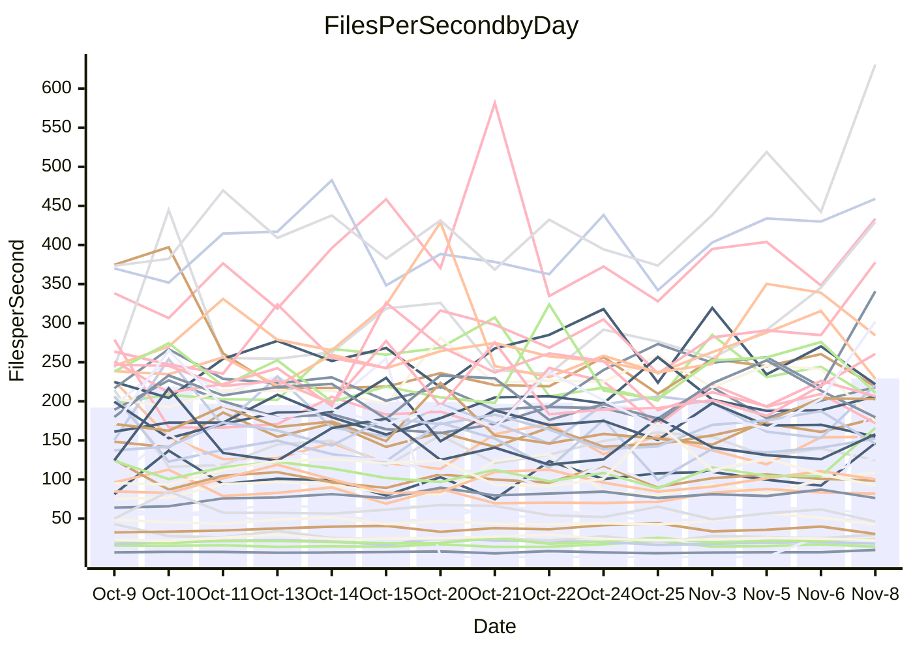

<!---
# This file is auto-generated. Do not edit.
# cspell:disable
--->
# Performance Report

Daily Performance

Time to Process Files

| Repository                                      | Elapsed | Min/Avg/Max          |    SD | SD Graph                |
| ----------------------------------------------- | ------: | :------------------: | ----: | ----------------------- |
| AdaDoom3/AdaDoom3                    |    3.39 | 1.8 /   2.8 /   3.5  |  0.46 | `    ┣━━┻━━╋━━●━━┫    ` |
| alexiosc/megistos                    |    5.34 | 3.9 /   6.5 /   9.3  |  1.39 | `    ┣━━●━━╋━━┻━━┫    ` |
| apollographql/apollo-server          |    1.54 | 1.4 /   2.4 /   3.3  |  0.43 | `    ●━━┻━━╋━━┻━━┫    ` |
| aspnetboilerplate/aspnetboilerplate  |    8.12 | 5.1 /   8.0 /  10.2  |  1.60 | `    ┣━━┻━━●━━┻━━┫    ` |
| aws-amplify/docs                     |   13.89 | 7.4 /  12.7 /  15.4  |  2.34 | `   ┣━━━┻━━╋━●┻━━━┫   ` |
| Azure/azure-rest-api-specs           |   11.39 | 6.2 /  10.0 /  12.2  |  1.71 | `    ┣━━┻━━╋━━●━━┫    ` |
| bitjson/typescript-starter           |    1.11 | 0.7 /   1.0 /   1.3  |  0.17 | `     ┣━┻━━╋●━┻━┫     ` |
| caddyserver/caddy                    |    4.08 | 2.3 /   3.9 /   4.8  |  0.69 | `    ┣━━┻━━╋●━┻━━┫    ` |
| canada-ca/open-source-logiciel-libre |    0.71 | 0.7 /   1.1 /   1.4  |  0.18 | `     ●━┻━━╋━━┻━┫     ` |
| chef/chef                            |    4.96 | 0.0 /   1.8 /   5.5  |  2.35 | `    ┣━━┻━━╋━━┻●━┫    ` |
| dart-lang/sdk                        |   45.41 | 35.8 /  57.4 /  76.1 |  8.96 | `  ┣━━●┻━━━╋━━━┻━━━┫  ` |
| django/django                        |   14.59 | 7.6 /  13.0 /  15.6  |  2.48 | `   ┣━━━┻━━╋━●┻━━━┫   ` |
| eslint/eslint                        |   11.95 | 5.8 /   9.5 /  11.5  |  1.59 | `    ┣━━┻━━╋━━┻━●┫    ` |
| exonum/exonum                        |    3.37 | 2.0 /   3.1 /   3.9  |  0.54 | `    ┣━━┻━━╋●━┻━━┫    ` |
| flutter/samples                      |   11.69 | 6.7 /  10.5 /  13.0  |  1.88 | `    ┣━━┻━━╋━●┻━━┫    ` |
| gitbucket/gitbucket                  |    2.76 | 1.9 /   3.2 /   4.5  |  0.58 | `    ┣━━┻●━╋━━┻━━┫    ` |
| googleapis/google-cloud-cpp          |   73.19 | 72.6 / 119.3 / 144.0 | 19.75 | `● ┣━━━┻━━━╋━━━┻━━━┫  ` |
| graphql/express-graphql              |    1.15 | 0.7 /   1.1 /   1.4  |  0.19 | `     ┣━┻━━╋●━┻━┫     ` |
| graphql/graphql-js                   |    2.51 | 2.1 /   3.3 /   4.4  |  0.69 | `    ┣━━●━━╋━━┻━━┫    ` |
| graphql/graphql-relay-js             |    0.96 | 0.7 /   1.1 /   1.4  |  0.18 | `     ┣━┻●━╋━━┻━┫     ` |
| graphql/graphql-spec                 |    1.35 | 0.8 /   1.3 /   1.6  |  0.21 | `     ┣━┻━━╋●━┻━┫     ` |
| iluwatar/java-design-patterns        |   13.01 | 7.4 /  11.7 /  14.6  |  2.17 | `    ┣━━┻━━╋━●┻━━┫    ` |
| ktaranov/sqlserver-kit               |    3.34 | 3.3 /   5.2 /   6.8  |  1.13 | `    ┣●━┻━━╋━━┻━━┫    ` |
| liriliri/licia                       |    3.14 | 2.3 /   3.6 /   4.7  |  0.68 | `    ┣━━┻●━╋━━┻━━┫    ` |
| MartinThoma/LaTeX-examples           |    6.71 | 3.8 /   6.0 /   7.5  |  1.06 | `    ┣━━┻━━╋━●┻━━┫    ` |
| mdx-js/mdx                           |    1.70 | 1.2 /   1.7 /   2.1  |  0.27 | `     ┣━┻━━●━━┻━┫     ` |
| microsoft/TypeScript-Website         |    4.29 | 3.1 /   4.9 /   6.3  |  0.81 | `    ┣━━┻●━╋━━┻━━┫    ` |
| MicrosoftDocs/PowerShell-Docs        |   19.80 | 14.4 /  23.5 /  28.1 |  3.37 | `   ┣━━●┻━━╋━━┻━━━┫   ` |
| neovim/nvim-lspconfig                |    4.38 | 3.1 /   5.2 /   6.8  |  1.03 | `    ┣━━┻●━╋━━┻━━┫    ` |
| pagekit/pagekit                      |    2.17 | 2.1 /   3.3 /   4.1  |  0.57 | `    ●━━┻━━╋━━┻━━┫    ` |
| php/php-src                          |   25.98 | 13.6 /  22.1 /  28.0 |  4.22 | `   ┣━━━┻━━╋━━●━━━┫   ` |
| plasticrake/tplink-smarthome-api     |    1.32 | 0.8 /   1.2 /   1.6  |  0.23 | `     ┣━┻━━╋●━┻━┫     ` |
| prettier/prettier                    |    6.44 | 4.5 /   7.6 /   9.3  |  1.31 | `    ┣━━●━━╋━━┻━━┫    ` |
| pycontribs/jira                      |    1.73 | 0.9 /   1.4 /   1.9  |  0.23 | `     ┣━┻━━╋━━┻●┫     ` |
| RustPython/RustPython                |   10.67 | 6.5 /  10.6 /  13.3  |  2.10 | `    ┣━━┻━━●━━┻━━┫    ` |
| shoelace-style/shoelace              |    2.84 | 1.7 /   2.6 /   3.2  |  0.46 | `    ┣━━┻━━╋━●┻━━┫    ` |
| slint-ui/slint                       |   22.67 | 11.7 /  18.7 /  23.4 |  3.61 | `   ┣━━━┻━━╋━━┻●━━┫   ` |
| SoftwareBrothers/admin-bro           |    2.02 | 1.5 /   2.4 /   3.2  |  0.39 | `    ┣━━●━━╋━━┻━━┫    ` |
| sveltejs/svelte                      |   14.62 | 13.2 /  21.9 /  27.1 |  3.91 | `   ┣●━━┻━━╋━━┻━━━┫   ` |
| TheAlgorithms/Python                 |    4.34 | 3.9 /   6.1 /   7.6  |  1.07 | `    ┣●━┻━━╋━━┻━━┫    ` |
| twbs/bootstrap                       |    1.99 | 1.1 /   1.9 /   2.3  |  0.30 | `     ┣━┻━━╋●━┻━┫     ` |
| typescript-cheatsheets/react         |    1.00 | 0.8 /   1.2 /   1.4  |  0.17 | `     ┣━●━━╋━━┻━┫     ` |
| typescript-eslint/typescript-eslint  |    4.30 | 2.5 /   4.1 /   4.8  |  0.71 | `    ┣━━┻━━╋●━┻━━┫    ` |
| vitest-dev/vitest                    |    6.86 | 6.4 /  10.5 /  13.1  |  2.07 | `    ●━━┻━━╋━━┻━━┫    ` |
| w3c/aria-practices                   |    2.74 | 2.0 /   3.0 /   4.2  |  0.58 | `    ┣━━┻━●╋━━┻━━┫    ` |
| w3c/specberus                        |    1.48 | 1.2 /   1.7 /   2.3  |  0.34 | `     ┣━┻●━╋━━┻━┫     ` |
| webdeveric/webpack-assets-manifest   |    1.30 | 0.8 /   1.2 /   1.4  |  0.16 | `     ┣━┻━━╋━●┻━┫     ` |
| webpack/webpack                      |    7.46 | 5.3 /   8.3 /  10.4  |  1.52 | `    ┣━━┻●━╋━━┻━━┫    ` |
| wireapp/wire-desktop                 |    1.54 | 0.9 /   1.4 /   1.7  |  0.23 | `     ┣━┻━━╋━●┻━┫     ` |
| wireapp/wire-webapp                  |   15.60 | 8.8 /  13.5 /  18.3  |  2.80 | `   ┣━━━┻━━╋━●┻━━━┫   ` |

Note:
- Elapsed time is in seconds.

Files per Second over Time

| Repository                                      | Files |   Sec |    Fps |     Rel | Trend Fps              |    N |
| ----------------------------------------------- | ----: | ----: | -----: | ------: | ---------------------- | ---: |
| AdaDoom3/AdaDoom3                    |   103 |  3.39 |  30.36 | -18.86% | `▁▂▅▂▂▂▂▆▂▄█▂▂█▂▄▂▃▅▂` |   46 |
| alexiosc/megistos                    |   583 |  5.34 | 109.09 |  15.72% | `▂▃▂█▂▃▂▂▅▇▂▅▇▅▆▂▁▃▃▅` |   46 |
| apollographql/apollo-server          |   256 |  1.54 | 165.95 |  52.44% | `▅▆▃▃▃▄▂▄▃▃▅▄▃▁▃▂▂▃██` |   46 |
| aspnetboilerplate/aspnetboilerplate  |  2308 |  8.12 | 284.39 |  -6.11% | `▂▂▂▂▅▇▅▂██▆▇▃▅█▂▂▅▅▃` |   46 |
| aws-amplify/docs                     |  3039 | 13.89 | 218.75 | -12.59% | `▇▂▂▁▂▅▄▂▁▃▂▅▂▂▄█▂▃▂▂` |   46 |
| Azure/azure-rest-api-specs           |  2607 | 11.39 | 228.98 | -15.28% | `▄▂▄▂▄▅▁▄▄▂█▂▇▇▂█▆▂▂▂` |   46 |
| bitjson/typescript-starter           |    20 |  1.11 |  18.00 | -11.34% | `▂▃▃▃▂█▃▃▃▂▃▅▅▁▄▇▃▂█▃` |   46 |
| caddyserver/caddy                    |   402 |  4.08 |  98.57 |  -4.69% | `▂▂▂▆▂▂▅▂▇▂▂▅▄█▂▁▂▂▁▃` |   46 |
| canada-ca/open-source-logiciel-libre |     7 |  0.71 |   9.93 |  44.37% | `▁▃▂▇▅▂▆▅▂▄▃▂▅▆▅▄▂▂▅█` |   46 |
| chef/chef                            |  1040 |  4.96 | 209.62 | 151.72% | `▁▁▁▁▁▁▁▁▁▁▁▁▁▁▁▁▁▁█▆` |   45 |
| dart-lang/sdk                        | 11839 | 45.41 | 260.71 |  23.32% | `▅▃▃▂▃▂▂▃▁▂█▅▃▄▂▃▃▃▅▅` |   46 |
| django/django                        |  2941 | 14.59 | 201.56 | -15.16% | `▇▂▂█▁▆▁▃▁▃▂▃▂▂▁▆▇▄▁▂` |   46 |
| eslint/eslint                        |  2087 | 11.95 | 174.69 | -23.50% | `▁▅▂▂▂▇▄▂▅███▂▂▂▂▁▂▂▁` |   46 |
| exonum/exonum                        |   421 |  3.37 | 124.74 | -10.76% | `▂▅█▅▂▁▂▅▅▂▄▂▂▂█▂▆▃▇▃` |   46 |
| flutter/samples                      |  1703 | 11.69 | 145.72 | -13.20% | `▂▆▃▃▄▆▂▅▂▅▅▁▄▂▆▃█▂▇▂` |   46 |
| gitbucket/gitbucket                  |   427 |  2.76 | 154.57 |   9.67% | `▅▄▃▃▂▃▃▃▃█▂▅▂▅██▅▁▅▅` |   46 |
| googleapis/google-cloud-cpp          | 22116 | 73.19 | 302.16 |  57.59% | `▃▄▂▂▂▂▂▂▁▄▂▂▂▁▁▅▇▂██` |   46 |
| graphql/express-graphql              |    26 |  1.15 |  22.53 |  -9.92% | `▂▂▂▆▁█▂▂▆▂▂▃▁▃▂█▂▄▄▃` |   46 |
| graphql/graphql-js                   |   556 |  2.51 | 221.29 |  25.98% | `▂▄▆█▇▂▁▂▂▂▂▅▂▂▂▂▂▂▄▆` |   46 |
| graphql/graphql-relay-js             |    28 |  0.96 |  29.26 |  10.75% | `█▆▃▃▂▄▇▄▅█▃▃▃▅▃▃▃▂▄▆` |   46 |
| graphql/graphql-spec                 |    19 |  1.35 |  14.04 | -10.31% | `▆▂▁▂▂▂▆▂▂█▃▃▅▄▃▆▂▂█▃` |   46 |
| iluwatar/java-design-patterns        |  2239 | 13.01 | 172.16 | -13.63% | `▅▂█▃▄▂▂▅▃█▂▄▁▅▄▄▂▆▂▂` |   46 |
| ktaranov/sqlserver-kit               |   490 |  3.34 | 146.67 |  48.84% | `▂▆▂█▂▂▁▇▆▄▇▂▂▄▂▂▅▁▂█` |   46 |
| liriliri/licia                       |  1442 |  3.14 | 458.99 |  10.11% | `▄▅▂▂▇█▂▂▁▄▂▂▂▂▇▇▂█▂▅` |   46 |
| MartinThoma/LaTeX-examples           |  1414 |  6.71 | 210.75 | -13.17% | `▂▂▃▇▆▄▂▆▂▂▇▂▂█▂█▅▅▅▂` |   46 |
| mdx-js/mdx                           |   139 |  1.70 |  81.82 |  -0.22% | `▅▂▅▄▆▅█▂▂▄▇▃▄▂▆▄▆▂▂▄` |   46 |
| microsoft/TypeScript-Website         |   765 |  4.29 | 178.14 |  10.17% | `▂▂█▂▅▄█▂▃█▅▃▃▅▃▂▂▃▅▅` |   46 |
| MicrosoftDocs/PowerShell-Docs        |  3127 | 19.80 | 157.96 |  15.52% | `▂█▂▃▄▃▂▁▄▂▅▃▂▂▃▃▃▁▂▅` |   46 |
| neovim/nvim-lspconfig                |   889 |  4.38 | 203.05 |  14.31% | `▂▁▂▂▂▂▄▂▅▇▄▁▂▇▂▂█▆▄▄` |   46 |
| pagekit/pagekit                      |   741 |  2.17 | 340.84 |  48.56% | `▃▂▅▇▅▂▂▆█▂▂▂▂▅▂▂▅▁▅█` |   46 |
| php/php-src                          |  2403 | 25.98 |  92.49 | -18.15% | `▅▇▂▁▇▂▅█▅▂▂▂▅▂▂▇▂▇▂▂` |   46 |
| plasticrake/tplink-smarthome-api     |    62 |  1.32 |  46.86 | -12.40% | `▄▅▂▂▃▁▆▁██▆▂▂▂▂▂▃▇▂▃` |   46 |
| prettier/prettier                    |  2791 |  6.44 | 433.61 |  14.81% | `▂█▂▁▂▃▄▆▂▂▄▂▂▂▄▁▁▂▃▄` |   46 |
| pycontribs/jira                      |    80 |  1.73 |  46.20 | -20.89% | `▁▃▃▃▅▂▅▄▂█▃▇▃▅▄▃█▅▂▂` |   46 |
| RustPython/RustPython                |  1069 | 10.67 | 100.17 |  -1.44% | `▃▃▂▁▂▇▅▁▁▁▇▂█▇▁▄█▁▄▃` |   46 |
| shoelace-style/shoelace              |   440 |  2.84 | 154.92 | -12.17% | `▂▇█▂▂▁▅▂▇▂▃▅▄▂▂▅▆▂▂▂` |   46 |
| slint-ui/slint                       |  5027 | 22.67 | 221.75 | -16.74% | `▄▇▄█▂▂▂▂▄▂▂▄▇▃▂█▂▂█▂` |   46 |
| SoftwareBrothers/admin-bro           |   441 |  2.02 | 218.12 |  13.85% | `▃▇▆▃▃▂▃▂▅▄▃█▁▃▃▅▂▄█▅` |   46 |
| sveltejs/svelte                      |  9223 | 14.62 | 630.93 |  44.23% | `▁▂▅▄▄█▂▂▇▂▂▄▂▆▂█▂▂▂▇` |   46 |
| TheAlgorithms/Python                 |  1640 |  4.34 | 377.81 |  35.68% | `▂█▂▂▂▆▆▃▂▂▄▄▄▂▃▁▂▅█▇` |   46 |
| twbs/bootstrap                       |   152 |  1.99 |  76.25 |  -5.82% | `▄▂▆▂▅▂▃▂▂▂▄▅▄▄▄█▃▃▄▃` |   46 |
| typescript-cheatsheets/react         |    24 |  1.00 |  23.93 |  13.80% | `▃▂▄▃▂█▃▂▆▃▇▂▅▃▅▃▅█▃▆` |   46 |
| typescript-eslint/typescript-eslint  |   887 |  4.30 | 206.35 |  -9.01% | `▂▂▃▄▂▂▃▂▁▂█▄▃▃▃▂▃▁▅▃` |   46 |
| vitest-dev/vitest                    |  2948 |  6.86 | 429.54 |  48.22% | `▄▂▂▁▂▆▂▂▄█▄▂█▂█▂█▂██` |   46 |
| w3c/aria-practices                   |   417 |  2.74 | 152.33 |   6.49% | `▂▃█▃▂▂▇▅▃▄▃▂▄▆▃▇▅▂▅▅` |   46 |
| w3c/specberus                        |   190 |  1.48 | 127.98 |  10.62% | `▂▂█▃▃▂▇▇▇▃▂▅▄▄▃▂▂▃▇▅` |   46 |
| webdeveric/webpack-assets-manifest   |    55 |  1.30 |  42.43 | -11.87% | `▂▆▂▂▂█▃▇█▄▇▂█▂▂▃▇▂▂▂` |   46 |
| webpack/webpack                      |  1540 |  7.46 | 206.37 |   8.71% | `▂▄█▂▂▂▃▄▄▂▄▄▁▁█▂▂▂▇▄` |   46 |
| wireapp/wire-desktop                 |    86 |  1.54 |  55.76 |  -8.49% | `▂▄▂▄▂▅▇▃▃▂▂▂▂▆▃▂▄▆█▃` |   46 |
| wireapp/wire-webapp                  |  2803 | 15.60 | 179.65 | -16.62% | `▅▂▇▂██▂█▁▂▂▃▂██▂▂▅▂▂` |   46 |

Data Throughput

| Repository                                      | Files |   Sec |     Kps |     Rel | Trend Kps              |    N |
| ----------------------------------------------- | ----: | ----: | ------: | ------: | ---------------------- | ---: |
| AdaDoom3/AdaDoom3                    |   103 |  3.39 |  645.23 | -18.86% | `▁▂▅▂▂▂▂▆▂▄█▂▂█▂▄▂▃▅▂` |   46 |
| alexiosc/megistos                    |   583 |  5.34 |  857.17 |  15.72% | `▂▃▂█▂▃▂▂▅▇▂▅▇▅▆▂▁▃▃▅` |   46 |
| apollographql/apollo-server          |   256 |  1.54 | 1370.35 |  52.44% | `▅▆▃▃▃▄▂▄▃▃▅▄▃▁▃▂▂▃██` |   46 |
| aspnetboilerplate/aspnetboilerplate  |  2308 |  8.12 |  701.61 |  -5.94% | `▂▂▂▂▅▇▅▂██▆▇▃▅█▂▂▅▅▃` |   46 |
| aws-amplify/docs                     |  3039 | 13.89 |  859.76 | -12.58% | `▇▂▂▁▂▅▄▂▁▃▂▅▂▂▄█▂▃▂▂` |   46 |
| Azure/azure-rest-api-specs           |  2607 | 11.39 |  720.49 | -14.63% | `▄▂▄▂▄▅▁▄▄▂█▃▇▇▂█▆▂▂▂` |   46 |
| bitjson/typescript-starter           |    20 |  1.11 |   72.02 | -11.34% | `▂▃▃▃▂█▃▃▃▂▃▅▅▁▄▇▃▂█▃` |   46 |
| caddyserver/caddy                    |   402 |  4.08 |  962.89 |  -2.76% | `▂▂▃▆▂▂▅▂▇▃▂▅▅█▂▂▂▂▂▃` |   46 |
| canada-ca/open-source-logiciel-libre |     7 |  0.71 |   82.26 |  44.37% | `▁▃▂▇▅▂▆▅▂▄▃▂▅▆▅▄▂▂▅█` |   46 |
| chef/chef                            |  1040 |  4.96 | 1033.37 |  -3.96% | `▂▇▃▄▂▆▂▃▃▇▅▃▂▂▃▇█▃`   |   17 |
| dart-lang/sdk                        | 11839 | 45.41 | 1832.22 |  23.55% | `▅▃▃▂▃▂▂▃▁▂█▅▃▄▂▃▃▃▅▅` |   46 |
| django/django                        |  2941 | 14.59 | 1309.63 | -15.03% | `▇▂▂█▁▆▁▃▁▃▂▃▂▂▁▆▇▄▁▂` |   46 |
| eslint/eslint                        |  2087 | 11.95 | 1237.91 | -23.42% | `▁▅▂▂▂▇▄▂▅███▂▂▂▂▁▂▂▁` |   46 |
| exonum/exonum                        |   421 |  3.37 | 1193.22 | -10.76% | `▂▅█▅▂▁▂▅▅▂▄▂▂▂█▂▆▃▇▃` |   46 |
| flutter/samples                      |  1703 | 11.69 |  868.58 | -13.20% | `▂▆▃▃▄▆▂▅▂▅▅▁▄▂▆▃█▂▇▂` |   46 |
| gitbucket/gitbucket                  |   427 |  2.76 |  763.09 |  10.17% | `▅▄▃▃▂▃▃▃▃█▂▅▂▅██▅▁▅▅` |   46 |
| googleapis/google-cloud-cpp          | 22116 | 73.19 | 2650.29 |  57.97% | `▃▄▂▂▂▂▂▂▁▄▂▂▂▁▁▅▇▂██` |   46 |
| graphql/express-graphql              |    26 |  1.15 |  103.10 |  -9.92% | `▂▂▂▆▁█▂▂▆▂▂▃▁▃▂█▂▄▄▃` |   46 |
| graphql/graphql-js                   |   556 |  2.51 | 1690.74 |  27.19% | `▂▄▆█▇▂▁▂▂▂▂▅▂▂▂▂▂▂▄▆` |   46 |
| graphql/graphql-relay-js             |    28 |  0.96 |  114.94 |  10.75% | `█▆▃▃▂▄▇▄▅█▃▃▃▅▃▃▃▂▄▆` |   46 |
| graphql/graphql-spec                 |    19 |  1.35 |  472.17 | -10.31% | `▆▂▁▂▂▂▆▂▂█▃▃▅▄▃▆▂▂█▃` |   46 |
| iluwatar/java-design-patterns        |  2239 | 13.01 |  534.16 | -13.63% | `▅▂█▃▄▂▂▅▃█▂▄▁▅▄▄▂▆▂▂` |   46 |
| ktaranov/sqlserver-kit               |   490 |  3.34 | 2222.87 |  48.87% | `▂▆▂█▂▂▁▇▆▄▇▂▂▄▂▂▅▁▂█` |   46 |
| liriliri/licia                       |  1442 |  3.14 |  550.34 |  10.11% | `▄▅▂▂▇█▂▂▁▄▂▂▂▂▇▇▂█▂▅` |   46 |
| MartinThoma/LaTeX-examples           |  1414 |  6.71 |  437.90 | -13.17% | `▂▂▃▇▆▄▂▆▂▂▇▂▂█▂█▅▅▅▂` |   46 |
| mdx-js/mdx                           |   139 |  1.70 |  385.57 |  -0.22% | `▅▂▅▄▆▅█▂▂▄▇▃▄▂▆▄▆▂▂▄` |   46 |
| microsoft/TypeScript-Website         |   765 |  4.29 | 1229.26 |  10.21% | `▂▂█▂▅▄█▂▃█▅▃▃▅▃▂▂▃▅▅` |   46 |
| MicrosoftDocs/PowerShell-Docs        |  3127 | 19.80 | 1688.07 |  15.52% | `▂█▂▃▄▃▂▁▄▂▅▃▂▂▃▃▃▁▂▅` |   46 |
| neovim/nvim-lspconfig                |   889 |  4.38 |  642.04 |  14.64% | `▂▁▂▂▂▂▄▂▅▇▄▁▂▇▂▂█▆▄▄` |   46 |
| pagekit/pagekit                      |   741 |  2.17 |  710.66 |  48.56% | `▃▂▅▇▅▂▂▆█▂▂▂▂▅▂▂▅▁▅█` |   46 |
| php/php-src                          |  2403 | 25.98 | 1645.78 | -18.15% | `▅▇▂▁▇▂▅█▅▂▂▂▅▂▂▇▂▇▂▂` |   46 |
| plasticrake/tplink-smarthome-api     |    62 |  1.32 |  253.19 | -12.40% | `▄▅▂▂▃▁▆▁██▆▂▂▂▂▂▃▇▂▃` |   46 |
| prettier/prettier                    |  2791 |  6.44 |  604.50 |  14.45% | `▂█▂▁▂▃▄▆▂▂▄▂▂▂▄▁▁▂▃▄` |   46 |
| pycontribs/jira                      |    80 |  1.73 |  326.27 | -20.89% | `▁▃▃▃▅▂▅▄▂█▃▇▃▅▄▃█▅▂▂` |   46 |
| RustPython/RustPython                |  1069 | 10.67 | 2890.48 |  -2.38% | `▃▃▂▁▂▇▅▁▁▁▇▂█▇▁▄█▁▄▃` |   46 |
| shoelace-style/shoelace              |   440 |  2.84 |  748.17 | -12.17% | `▂▇█▂▂▁▅▂▇▂▃▅▄▂▂▅▆▂▂▂` |   46 |
| slint-ui/slint                       |  5027 | 22.67 | 1332.42 | -15.45% | `▄▇▄█▂▂▂▂▅▂▂▄▇▃▂█▂▂█▂` |   46 |
| SoftwareBrothers/admin-bro           |   441 |  2.02 |  480.76 |  13.85% | `▃▇▆▃▃▂▃▂▅▄▃█▁▃▃▅▂▄█▅` |   46 |
| sveltejs/svelte                      |  9223 | 14.62 |  436.72 |  44.37% | `▁▂▅▄▄█▂▂▇▂▂▄▂▆▂█▂▂▂▇` |   46 |
| TheAlgorithms/Python                 |  1640 |  4.34 | 1083.68 |  35.80% | `▂█▂▂▂▆▆▃▂▂▄▄▄▂▃▁▂▅█▇` |   46 |
| twbs/bootstrap                       |   152 |  1.99 |  644.59 |  -5.25% | `▄▂▆▂▅▂▃▂▃▂▄▅▄▄▄█▃▃▄▃` |   46 |
| typescript-cheatsheets/react         |    24 |  1.00 |  216.35 |  13.80% | `▃▂▄▃▂█▃▂▆▃▇▂▅▃▅▃▅█▃▆` |   46 |
| typescript-eslint/typescript-eslint  |   887 |  4.30 |  705.60 |  -8.83% | `▂▂▃▄▂▂▃▂▁▂█▄▃▃▃▂▃▁▅▃` |   46 |
| vitest-dev/vitest                    |  2948 |  6.86 | 1298.51 |  49.27% | `▄▂▂▂▂▆▂▂▄█▄▂█▂█▂█▂██` |   46 |
| w3c/aria-practices                   |   417 |  2.74 | 1434.14 |   6.49% | `▂▃█▃▂▂▇▅▃▄▃▂▄▆▃▇▅▂▅▅` |   46 |
| w3c/specberus                        |   190 |  1.48 |  418.96 |  10.62% | `▂▂█▃▃▂▇▇▇▃▂▅▄▄▃▂▂▃▇▅` |   46 |
| webdeveric/webpack-assets-manifest   |    55 |  1.30 |   97.97 | -11.87% | `▂▆▂▂▂█▃▇█▄▇▂█▂▂▃▇▂▂▂` |   46 |
| webpack/webpack                      |  1540 |  7.46 | 1794.48 |   7.73% | `▂▄█▂▂▂▃▄▄▂▄▄▁▁█▂▂▂▇▄` |   46 |
| wireapp/wire-desktop                 |    86 |  1.54 |  245.08 |  -7.66% | `▂▄▃▄▃▅▇▃▃▃▂▂▃▆▃▂▄▆█▃` |   46 |
| wireapp/wire-webapp                  |  2803 | 15.60 |  856.77 | -14.93% | `▅▂▇▂██▂█▁▂▂▃▂██▂▂▅▂▂` |   46 |

